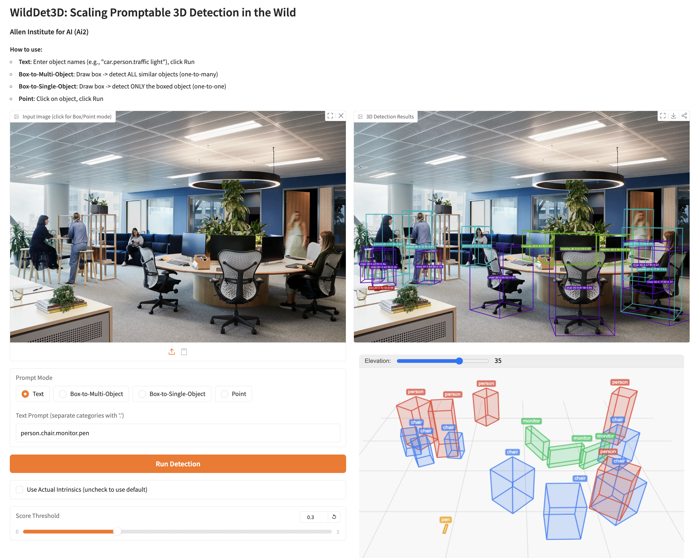
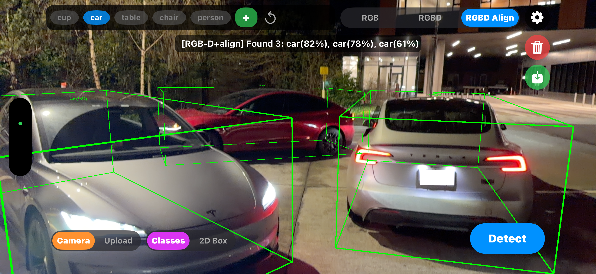
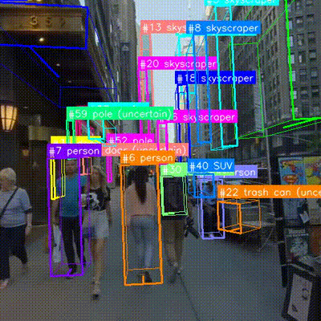
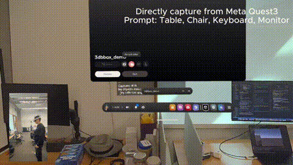
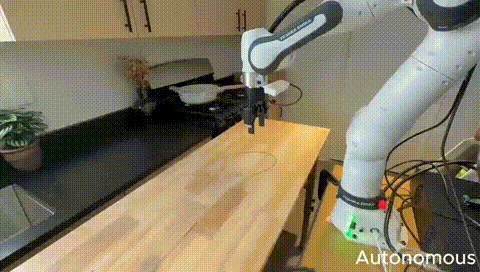
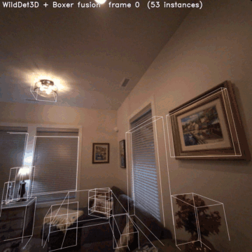
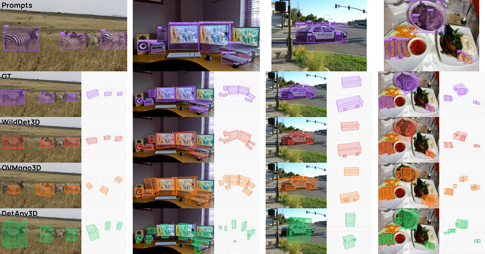
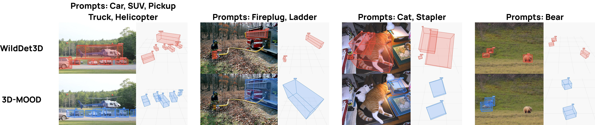

<div align="center">
  
  <br>

<a href="https://youtu.be/RgHKmOqb7I4">观看完整演示视频</a>

# WildDet3D：<br>面向真实场景的大规模提示式 3D 检测

<a href="https://allenai.org/papers/wilddet3d" target="_blank">
    
</a>
<a href="https://huggingface.co/allenai/WildDet3D" target="_blank">
    
</a>
<a href="https://huggingface.co/datasets/allenai/WildDet3D-Data" target="_blank">
    
</a>
<a href="https://huggingface.co/spaces/allenai/WildDet3D" target="_blank">
    
</a>
<a href="https://huggingface.co/collections/allenai/wilddet3d-69d42220ec4f942f1951263e" target="_blank">
    
</a>
<a href="https://apps.apple.com/us/app/wilddet3d/id6760861157" target="_blank">
    
</a>
<a href="https://allenai.github.io/WildDet3D/" target="_blank">
    
</a>
<a href="https://allenai.org/blog/wilddet3d" target="_blank">
    
</a>

<p style="width:80%; margin:auto">
    <a href="https://weikaih04.github.io/" target="_blank">Weikai Huang</a><sup style="color:#FF69B4">&#9829;</sup><sup>1,2</sup>&nbsp;&nbsp;
    <a href="https://jieyuz2.github.io/" target="_blank">Jieyu Zhang</a><sup style="color:#FF69B4">&#9829;</sup><sup>1,2</sup>
    <br>
    <a href="https://github.com/Silicon23" target="_blank">Sijun Li</a><sup>2</sup>&nbsp;&nbsp;
    <a href="https://github.com/taoyangJ" target="_blank">Taoyang Jia</a><sup>2</sup>&nbsp;&nbsp;
    <a href="https://duanjiafei.com/" target="_blank">Jiafei Duan</a><sup>1,2</sup>&nbsp;&nbsp;
    <a href="https://scholar.google.com/citations?user=Li5XdUsAAAAJ" target="_blank">Yunqian Cheng</a><sup>1</sup>&nbsp;&nbsp;
    <a href="https://j-min.io/" target="_blank">Jaemin Cho</a><sup>1,2</sup>&nbsp;&nbsp;
    <a href="https://mattwallingford.github.io/" target="_blank">Matthew Wallingford</a><sup>1</sup>&nbsp;&nbsp;
    <a href="https://github.com/RustinS" target="_blank">Rustin Soraki</a><sup>1,2</sup>&nbsp;&nbsp;
    <a href="https://cdjkim.github.io/" target="_blank">Chris Dongjoo Kim</a><sup>1</sup>&nbsp;&nbsp;
    <a href="https://shuoliu1024.github.io/" target="_blank">Shuo Liu</a><sup>1,2</sup>&nbsp;&nbsp;
    <a href="https://www.linkedin.com/in/donovanclay/" target="_blank">Donovan Clay</a><sup>1,2</sup>&nbsp;&nbsp;
    <a href="https://www.linkedin.com/in/taira-anderson/" target="_blank">Taira Anderson</a><sup>1</sup>&nbsp;&nbsp;
    <a href="https://winsonhan.com/" target="_blank">Winson Han</a><sup>1</sup>
    <br>
    <a href="https://homes.cs.washington.edu/~ali/" target="_blank">Ali Farhadi</a><sup>1,2</sup>&nbsp;&nbsp;
    <a href="https://www.cs.cornell.edu/~bharathh/" target="_blank">Bharath Hariharan</a><sup>3</sup>&nbsp;&nbsp;
    <a href="https://jason718.github.io/" target="_blank">Zhongzheng Ren</a><sup style="color:#FF69B4">&#9829;</sup><sup>1,2,4</sup>&nbsp;&nbsp;
    <a href="https://ranjaykrishna.com/" target="_blank">Ranjay Krishna</a><sup style="color:#FF69B4">&#9829;</sup><sup>1,2</sup>
</p>

<p>
<span style="color:#FF69B4">&#9829;</span> 核心贡献者 &nbsp;&nbsp;
<sup>1</sup>艾伦人工智能研究所&nbsp;&nbsp;&nbsp;&nbsp;<sup>2</sup>华盛顿大学&nbsp;&nbsp;&nbsp;&nbsp;<sup>3</sup>康奈尔大学&nbsp;&nbsp;&nbsp;&nbsp;<sup>4</sup>北卡罗来纳大学教堂山分校
</p>

</div>

<a id="demo--applications"></a>

## 演示与应用

<table>
<tr>
<td align="center">
<a href="demo/huggingface/README.md"></a>
</td>
<td align="center">
<a href="demo/iphone/README.md"></a>
</td>
</tr>
<tr>
<td align="center">
<b>HuggingFace 交互式演示</b>
<br>支持文本、点和框提示的交互式网页演示
<br><a href="https://huggingface.co/spaces/allenai/WildDet3D">在线演示</a> | <a href="demo/huggingface/README.md">本地运行</a>
</td>
<td align="center">
<b>iPhone 应用</b>
<br>设备端实时 3D 检测
<br><a href="https://apps.apple.com/us/app/wilddet3d/id6760861157">应用商店</a> | <a href="https://youtu.be/LJPNJ8jpOao">视频</a> | <a href="demo/iphone/README.md">说明文档</a>
</td>
</tr>
<tr><td colspan="2"></td></tr>
<tr>
<td align="center">
<a href="demo/vlm/README.md"></a>
</td>
<td align="center">
<a href="demo/tracking/README.md"></a>
</td>
</tr>
<tr>
<td align="center">
<b>与视觉语言模型集成</b>
<br>结合视觉语言模型使用
<br><a href="demo/vlm/README.md">说明文档</a>
</td>
<td align="center">
<b>零样本跟踪</b>
<br>无需额外训练的 3D 目标跟踪
<br><a href="demo/tracking/README.md">说明文档</a>
</td>
</tr>
<tr><td colspan="2"></td></tr>
<tr>
<td align="center">
<a href="demo/meta_quest/README.md"></a>
</td>
<td align="center">
<a href="demo/robotics/README.md"></a>
</td>
</tr>
<tr>
<td align="center">
<b>Meta Quest</b>
<br>增强现实／虚拟现实中的 3D 检测
<br><a href="assets/demo_meta_quest.mp4">视频</a>
</td>
<td align="center">
<b>机器人应用</b>
<br>用于机器人操作的 3D 感知
<br><a href="assets/demo_robotics.mp4">视频</a>
</td>
</tr>
<tr><td colspan="2"></td></tr>
<tr>
<td align="center" colspan="2">
<a href="demo/boxer/README.md"></a>
</td>
</tr>
<tr>
<td align="center" colspan="2">
<b>集成 Meta FAIR 的 Boxer 演示，用于室内标注</b>
<br>WildDet3D 在面向 Project Aria 的 <a href="https://github.com/facebookresearch/boxer">Meta FAIR Boxer</a> 室内标注流程中替代 OWL + BoxerNet。Boxer 的 AriaLoader、离线融合、在线跟踪器及 3D 查看器均可直接使用本项目输出，无需修改。
<br><a href="demo/boxer/README.md">说明文档</a>
</td>
</tr>
</table>

<a id="news"></a>

## 更新动态

- **2026-05-20** — 发布 Omni3D、ScanNet、Argoverse 2 评测配置（文本／框提示 × 单目／真实深度，每个数据集各 4 种模式）。 ([#15](https://github.com/allenai/WildDet3D/pull/15))
- **2026-05-18** — 新增 Boxer 演示：将 WildDet3D 作为检测器接入面向 Project Aria 的 [Meta FAIR Boxer](https://github.com/facebookresearch/boxer) 室内标注流程。 ([#13](https://github.com/allenai/WildDet3D/pull/13))
- **2026-05-17** — 发布 FoundationPose 数据准备脚本（数据提取、3D 包围框、Qwen-VLM 分类）。 ([#12](https://github.com/allenai/WildDet3D/pull/12))
- **2026-04-27** — 修复跟踪及 HuggingFace／VLM 演示中的坐标变换问题。 ([#8](https://github.com/allenai/WildDet3D/pull/8), [#9](https://github.com/allenai/WildDet3D/pull/9))
- **2026-04-19** — 发布训练代码、WildDet3D-Data 数据准备脚本，并修复推理与可视化问题。 ([#6](https://github.com/allenai/WildDet3D/pull/6))
- **2026-04-07** — 首次发布：推理代码、WildDet3D-Bench 评测、HuggingFace Space、iPhone 应用及项目主页。

<a id="todo"></a>

## 开发计划

- [x] 发布推理代码
- [x] 发布 WildDet3D-Bench 评测
- [x] 发布训练代码
- [x] 发布其他基准的评测（Omni3D、Argoverse2、ScanNet）
- [ ] 发布 WildDet3D-Embodied：在 Droid 等机器人数据上微调 WildDet3D，使其更适合机器人应用或用作机器人模型的骨干网络。

<a id="contents"></a>

## 目录

- [演示与应用](#demo--applications)
- [更新动态](#news)
- [模型权重](#model-weights)
- [安装](#installation)
- [阿里云 PPU 推理环境](#aliyun-ppu)
- [ego 数据预标注](#ego-preannotation)
- [VS Code SSH 与网页演示](#vscode-ssh)
- [推理](#inference)
- [评测](#evaluation)
  - [WildDet3D-Bench](#wilddet3d-bench)
  - [WildDet3D-Stereo4D-Bench](#wilddet3d-stereo4d-bench)
- [训练](#training)
  - [训练数据准备](#training-data-preparation) &rarr; 参阅 [docs/TRAINING_DATA.md](docs/TRAINING_DATA.md)
- [实验结果](#results)
  - [WildDet3D-Bench（真实场景）](#wilddet3d-bench-in-the-wild)
  - [Omni3D](#omni3d)
  - [零样本迁移（Argoverse 2 + ScanNet）](#zero-shot-transfer-argoverse-2--scannet)
- [WildDet3D 数据集](#wilddet3d-data)
- [引用](#citation)
- [致谢](#acknowledgements)
- [许可证](#license)

<a id="model-weights"></a>

## 模型权重

PPU 用户先完成[专用安装流程](#aliyun-ppu)，再按其中第 5 步从 OSS 挂载复制阶段 3 权重和 LingBot 的 `model.pt` 到本地。以下保留原项目命令；`huggingface-cli` 取决于已安装的 Hub 版本。

| 权重文件 | 阶段 | 训练方案 | 大小 | 下载 |
|---|---|---|---|---|
| `wilddet3d_alldata_all_prompt_v1.0.pt` | 阶段 3（论文模型） | 阶段 2 权重 &rarr; Omni3D + ITW-human 混合提示微调，3 轮 | ~4.7 GB | [allenai/WildDet3D](https://huggingface.co/allenai/WildDet3D/resolve/main/wilddet3d_alldata_all_prompt_v1.0.pt) |
| `wilddet3d_stage2_alldata_12e_v1.0.pt` | 阶段 2（中间权重） | 阶段 1 权重 &rarr; 8 个数据集的全量数据微调，12 轮 | ~4.7 GB | [allenai/WildDet3D](https://huggingface.co/allenai/WildDet3D/resolve/main/wilddet3d_stage2_alldata_12e_v1.0.pt) |
| `wilddet3d_stage1_omni3d_12e_v1.0.pt` | 阶段 1（中间权重） | 仅使用 Omni3D、规范旋转表示，从头训练 12 轮 | ~4.7 GB | [allenai/WildDet3D](https://huggingface.co/allenai/WildDet3D/resolve/main/wilddet3d_stage1_omni3d_12e_v1.0.pt) |

三个权重采用相同架构（SAM3 ViT 骨干网络 + LingBot-Depth DINOv2 ViT-L/14 几何后端，约 12 亿参数），保存格式均为移除优化器状态后的 `state_dict` + `epoch`/`step` + `hparams`。按需要选择相应阶段；复现论文结果或直接推理时，使用 `wilddet3d_alldata_all_prompt_v1.0.pt`。

```bash
# 下载论文发布权重（约 4.7 GB）
pip install huggingface_hub
huggingface-cli download allenai/WildDet3D wilddet3d_alldata_all_prompt_v1.0.pt --local-dir ckpt/
```

**中间阶段权重（用于部分复现三阶段训练，直接推理无需下载）：**

```bash
# 阶段 1：仅使用 Omni3D、规范旋转，12 轮（约 4.7 GB）
huggingface-cli download allenai/WildDet3D wilddet3d_stage1_omni3d_12e_v1.0.pt --local-dir ckpt/

# 阶段 2：从阶段 1 开始，在 8 个数据集上全量微调 12 轮（约 4.7 GB）
huggingface-cli download allenai/WildDet3D wilddet3d_stage2_alldata_12e_v1.0.pt --local-dir ckpt/
```

如何将这些权重作为下一阶段的起点，请参阅 [`docs/TRAINING.md`](docs/TRAINING.md)。

<a id="installation"></a>

## 安装

阿里云 PPU 用户请先阅读下方专用流程，**不要执行本节 NVIDIA 安装命令**。

### 原项目 NVIDIA 环境（参考）

```bash
git clone --recurse-submodules https://github.com/allenai/WildDet3D.git
cd WildDet3D
# 克隆时若忘记 --recurse-submodules，执行下一行：
# git submodule update --init --recursive

# 训练还需要 MoGe（深度后端损失函数）；仅推理不需要：
# git clone https://github.com/microsoft/moge.git third_party/moge

conda create -n wilddet3d python=3.11 -y
conda activate wilddet3d

# 1. PyTorch（原项目测试的 CUDA／版本组合，仅用于 NVIDIA）
pip install torch==2.5.1 torchvision==0.20.1 --index-url https://download.pytorch.org/whl/cu121

# 2. vis4d（固定原项目使用的版本，复用上述 torch）
pip install vis4d==1.0.0

# 3. vis4d CUDA 算子（从源码编译，供 wilddet3d/ops 使用）
pip install git+https://github.com/SysCV/vis4d_cuda_ops.git --no-build-isolation --no-cache-dir

# 4. 其余依赖（包含 sam3 的间接依赖；
#    wilddet3d/__init__.py 通过 sys.path 加载 third_party/sam3，
#    因此不需要单独安装 sam3）
pip install -r requirements.txt
```

<a id="aliyun-ppu"></a>

### 阿里云 PPU 推理环境

本节用于在 **WildDet3D 专用 DSW 镜像**中加载阶段 3 权重，先验证单张 RGB 图片，再生成 ego 数据预标注。项目根目录现在是 `/mnt/workspace/wilddet3d`，不再是嵌套的 `WildDet3D/`。本流程不涉及训练；首次使用 FP32，关闭编译和可选 xFormers 加速。

**验证状态（2026-10-10）：当前默认 Python 导入项目时因缺少 `utils3d` 失败；受限工具中 `ppu-smi` 报驱动未加载，`torch.cuda.is_available()` 为 False。尚未安装本项目依赖、加载本地权重或完成 PPU 图像推理。下列命令是待在实际 DSW 终端执行的适配流程，不是已经跑通的记录。** 旧文档中 2026-09-30 的 Torch 2.6 环境和 CPU 加载结果不能作为当前镜像的验证结论。

| 项目 | 当前检查结果 |
|---|---|
| 项目目录 | `/mnt/workspace/wilddet3d` |
| 系统／Python | Ubuntu 24.04.2；Python 3.12.3；`/usr/local/bin/python3` |
| PyTorch／torchvision／torchaudio | `2.9.0`／`0.24.0`／`2.9.0` |
| CUDA API／PPU SDK | `torch.version.cuda == "13.0"`；SDK `2.1.0-a5f865` |
| 编译入口 | `/usr/local/PPU_SDK/CUDA_SDK/bin/nvcc` |
| Triton | `3.5.0+gitcc5446cf`，先保留镜像版本 |
| Torch 运行库 | 动态链接指向 PPU SDK；不能因包版本没有 PPU 后缀就认定是普通 NVIDIA 包 |
| 项目依赖 | 默认 Python 缺少 utils3d、vis4d、vis4d_cuda_ops、timm、ftfy、Gradio |
| 模型文件 | 两份 OSS 源文件存在；指定的本地副本尚不存在 |
| 输入图片 | `/mnt/workspace/ego/images` 尚不存在；首次可用 `demo/vlm/assets/` 中的测试图片 |
| 存储 | `/mnt/workspace` 所在盘剩余约 13 GB；`/tmp` 约 305 GB，都是检查时快照 |
| 设备容量 | 旧记录为单卡 ZW810E、96 GiB；当前工具未能读取设备，需实际终端复核 |

PPU 兼容接口仍使用 `device="cuda"`、`.cuda()` 和 CUDA Stream。保留镜像预装的软件栈，不执行上面的 NVIDIA Torch 安装命令。PPU 的 CUDA API 兼容能力不等于本模型全部算子已通过验证；参阅[阿里云 SDK 说明](https://help.aliyun.com/en/document_detail/2997009.html)及[PPU 编译器指南](https://help.aliyun.com/zh/document_detail/3030344.html)。如果后续镜像版本变化，重新执行以下检查，不按旧版本号强制降级。

#### 1. 在实际 DSW 终端验证设备

在 VS Code SSH 的远程终端执行，先使用镜像基础 Python。设备查询、矩阵运算、NMS、Stream 和标准 SDPA 都通过后，再安装项目依赖。

```bash
cd /mnt/workspace/wilddet3d
ppu-smi
command -v python3 nvcc
nvcc --version
/usr/local/bin/python3 -m pip show torch torchvision

/usr/local/bin/python3 -B - <<'PY'
import torch
import torch.nn.functional as F
import torchvision
from torch.nn.attention import SDPBackend, sdpa_kernel
from torch.utils.cpp_extension import CUDA_HOME
from torchvision.ops import nms

print("Python 使用的 PyTorch:", torch.__version__, torch.__file__)
print("torchvision:", torchvision.__version__)
print("CUDA API:", torch.version.cuda, "CUDA_HOME:", CUDA_HOME)
assert torch.cuda.is_available(), "当前解释器无法访问 PPU，先检查实际实例设备挂载和运行库"
print("设备:", torch.cuda.get_device_name(0))

x = torch.ones((16, 16), device="cuda")
stream = torch.cuda.Stream()
with torch.cuda.stream(stream):
    y = x @ x
stream.synchronize()
assert torch.allclose(y, torch.full_like(y, 16))
boxes = torch.tensor([[0., 0., 10., 10.], [1., 1., 9., 9.]], device="cuda")
scores = torch.tensor([0.9, 0.8], device="cuda")
assert nms(boxes, scores, 0.5).tolist() == [0]
q = torch.randn(1, 2, 16, 32, device="cuda")
with sdpa_kernel(SDPBackend.MATH):
    attention = F.scaled_dot_product_attention(q, q, q)
assert attention.shape == q.shape and torch.isfinite(attention).all()
torch.cuda.synchronize()
print("PPU 基础算子检查通过")
PY
```

若受限工具失败而 DSW 终端正常，继续在正常终端验证，不据此重装驱动。若实际终端也失败，先解决实例设备可见性；CPU 导入或模型构建通过不能替代 PPU 前向验证。

#### 2. 准备项目专用镜像与虚拟环境

每个项目使用独立镜像隔离系统软件栈。venv 在该镜像内选择 Python 和项目依赖，作用类似 Conda 环境，但不提供独立的 PPU 驱动；`--system-site-packages` 会继承基础包及其冲突。采用独立环境目录，不复用 ManiSkill 或 3d-mood 的环境。

**先处理专用镜像中的已知冲突。** 当前镜像预装的 `vllm==0.17.1+cu130` 要求 `pydantic>=2.12`、`opencv-python-headless>=4.13`，后者在 Python 3.12 要求 NumPy ≥ 2；[vis4d 1.0.0](https://pypi.org/pypi/vis4d/1.0.0/json)及 SAM3 要求 NumPy < 2，vis4d 还要求 Pydantic < 2。只新增一个继承系统包的 venv 不能消除这些冲突。

推荐使用不包含 vLLM 服务依赖的 PPU PyTorch 基础镜像。如果使用当前镜像的 **WildDet3D 专用副本，且其中不再运行 vLLM 或其他项目**，可记录依赖基线后移除 vLLM 和已有 OpenCV 提供者，后续仅安装 `opencv-python==4.11.0.86`。以下命令会修改该专用实例的基础 Python 包，不应在仍承担其他项目任务的实例执行。不会卸载 Torch、torchvision、torchaudio 或 Triton。

```bash
mkdir -p /mnt/workspace/wilddet3d-runtime
/usr/local/bin/python3 -m pip freeze > /mnt/workspace/wilddet3d-runtime/base-packages-before.txt
/usr/local/bin/python3 -m pip check > /mnt/workspace/wilddet3d-runtime/base-check-before.txt 2>&1 || true

# 仅在上述 WildDet3D 专用镜像条件成立时执行。
/usr/local/bin/python3 -m pip uninstall -y vllm \
    opencv-python-headless opencv-python \
    opencv-contrib-python-headless opencv-contrib-python

/usr/local/bin/python3 -m venv --system-site-packages /mnt/workspace/venvs/wilddet3d-ppu
source /mnt/workspace/venvs/wilddet3d-ppu/bin/activate
cd /mnt/workspace/wilddet3d
python -m pip --version
python -m pip check > /mnt/workspace/wilddet3d-runtime/base-check-after-cleanup.txt 2>&1 || true

# 只检查源码是否齐全，不改第三方目录。
test -f third_party/sam3/sam3/model_builder.py
test -f third_party/sam3/sam3/assets/bpe_simple_vocab_16e6.txt.gz
test -f third_party/lingbot_depth/mdm/model/v2.py
```

环境目录已存在时先核实其 Python、`pyvenv.cfg` 和用途，复用属于本项目的环境，不覆盖其他环境。VS Code 解释器选择 `/mnt/workspace/venvs/wilddet3d-ppu/bin/python`。

当前仓库已把 `third_party/sam3`、`third_party/lingbot_depth` 的源码作为普通文件跟踪；不要因保留了 `.gitmodules` 就执行子模块初始化或更新，避免丢失已有适配。仅推理无需 MoGe。当前代码已保留 SAM3 EDT 按需导入，以及 `build_model(..., lingbot_pretrained_model=...)` 本地文件参数。

#### 3. 安装依赖并保护 PPU 软件栈

**不要直接执行 `pip install -r requirements.txt`**：其中固定了 NVIDIA 路径使用的 Torch 2.5.1 和 torchvision 0.20.1。以下在虚拟环境目录生成安装材料，不改仓库原文件；固定当前 PPU 核心包版本并过滤训练数据准备使用的 pyarrow。

```bash
python -B - <<'PY'
from importlib.metadata import PackageNotFoundError, version
from pathlib import Path
import re
import sys

assert sys.prefix != sys.base_prefix, "先激活 wilddet3d-ppu"
target = Path(sys.prefix)
protected = []
for name in ("torch", "torchvision", "torchaudio", "triton"):
    try:
        protected.append(f"{name}=={version(name)}")
    except PackageNotFoundError:
        if name in ("torch", "torchvision"):
            raise
(target / "ppu-core-versions.txt").write_text("\n".join(protected) + "\n")
constraints = protected + [
    "numpy==1.26.4", "pydantic==1.10.26", "opencv-python==4.11.0.86",
    "setuptools<80", "timm>=1.0.17", "transformers<5", "huggingface_hub<1",
]
(target / "ppu-constraints.txt").write_text("\n".join(constraints) + "\n")
filtered = []
for line in Path("requirements.txt").read_text().splitlines():
    text = line.strip()
    if not text or text.startswith("#"):
        continue
    if re.match(r"^(torch|torchvision|pyarrow)(?:\s|[<>=!~;\[]|$)", text):
        continue
    filtered.append(line)
(target / "wilddet3d-inference-requirements.txt").write_text("\n".join(filtered) + "\n")
print((target / "ppu-constraints.txt").read_text())
PY

export PIP_CONSTRAINT="$VIRTUAL_ENV/ppu-constraints.txt"
mkdir -p /tmp/wilddet3d-build /tmp/wilddet3d-pip-cache
export TMPDIR=/tmp/wilddet3d-build
export PIP_CACHE_DIR=/tmp/wilddet3d-pip-cache

# 先看解析结果，遇到核心包替换或约束冲突，停止并定位。
python -m pip install --dry-run vis4d==1.0.0 \
    -r "$VIRTUAL_ENV/wilddet3d-inference-requirements.txt" ninja wheel psutil

# 解析结果符合约束后再执行。
python -m pip install vis4d==1.0.0 \
    -r "$VIRTUAL_ENV/wilddet3d-inference-requirements.txt" ninja wheel psutil

python -B - <<'PY'
from importlib.metadata import version
from pathlib import Path
import sys
import cv2
import numpy
import pkg_resources
import utils3d

for line in (Path(sys.prefix) / "ppu-core-versions.txt").read_text().splitlines():
    name, expected = line.split("==", 1)
    assert version(name) == expected, (name, version(name), expected)
assert hasattr(utils3d.pt, "depth_map_to_point_map"), "utils3d API 与本项目不匹配"
assert hasattr(utils3d, "np"), "utils3d 缺少 NumPy 后端"
print("核心包版本保持不变；OpenCV:", cv2.__version__, cv2.__file__)
print("NumPy:", numpy.__version__, "utils3d:", utils3d.__file__)
PY
python -m pip check
```

这里的依赖约束是待验证的安装方案，不是已经测得的完整兼容矩阵。`utils3d` 必须来自清单中的 `EasternJournalist/utils3d` Git 仓库；若当前上游版本缺少项目使用的 API，先记录提交并选择匹配版本，不能以同名无关包或空模块代替。完整推理通过后记录 Git 依赖的提交以便复现。

`setuptools<80` 沿用项目约束；当前 80.10.2 中 `pkg_resources` 实际仍可导入，不能把旧文档的“80+ 一律移除”当作实测结论。不要叠加网页依赖清单。`pip check` 中的 protobuf、click、urllib3 等基础镜像冲突需与两份基线对照，识别受影响包；项目新增冲突必须解决，不能宣称全部依赖通过。若清理 vLLM 后仍有其他包要求 Pydantic 2 或 NumPy 2，继续精简专用基础镜像或换合适的 PPU PyTorch 镜像，不忽略依赖硬装。

<a id="ppu-opencv-system-libs"></a>

**OpenCV 系统运行库按实际错误补齐。** 本次 `import cv2` 成功，`libGL.so.1`、GLib 和 GThread 均可找到，不需照搬旧记录重复安装。如果新的专用镜像使用 opencv-python 后出现这些库缺失，再执行：

```bash
apt-get update
apt-get install -y --no-install-recommends libgl1 libglib2.0-0t64
python -B -c 'import cv2; print(cv2.__version__, cv2.__file__)'
```

这些是系统包；仅修复相应动态库错误，不代表模型推理已经通过。多个 OpenCV 发行包共享 `cv2` 命名空间，应只保留一个提供者；参阅 [OpenCV 安装说明](https://pypi.org/project/opencv-python/4.11.0.86/)。

#### 4. 编译扩展并验证导入

先在激活的虚拟环境重新确认 PPU 可见。另一个项目环境已有通过 PPU 编译器构建的 vis4d 扩展，CPU 自身 IoU 检查结果为 1；这提供编译参考，但不证明本项目的 PPU 扩展运行通过。当前项目仍应在自己的环境安装并验证。

[上游构建脚本](https://github.com/SysCV/vis4d_cuda_ops/blob/d2478d80045b62f85be19235981a63ea9bc8db66/setup.py)只有在设备可见且找到 CUDA_HOME 时才加入设备源码，设备不可见时可能只构建 CPU 扩展。这里固定该源码提交，减少上游变化；若此提交需要补丁，先保留编译日志并确定修改范围。

```bash
export CUDA_HOME=/usr/local/PPU_SDK/CUDA_SDK
export PATH="$CUDA_HOME/bin:$PATH"
export MAX_JOBS=4
python -B -c 'import torch; assert torch.cuda.is_available(), "PPU 不可见，停止编译"'
command -v nvcc
nvcc --version

python -m pip install \
    git+https://github.com/SysCV/vis4d_cuda_ops.git@d2478d80045b62f85be19235981a63ea9bc8db66 \
    --no-build-isolation --no-cache-dir --no-deps

python -B - <<'PY'
import torch
from vis4d_cuda_ops import iou_box3d

corners = torch.tensor([
    [0., 0., 0.], [1., 0., 0.], [1., 1., 0.], [0., 1., 0.],
    [0., 0., 1.], [1., 0., 1.], [1., 1., 1.], [0., 1., 1.],
], device="cuda").unsqueeze(0).contiguous()
volume, iou = iou_box3d(corners, corners)
torch.cuda.synchronize()
assert torch.allclose(iou, torch.ones_like(iou), atol=1e-4), (volume, iou)
print("PPU 3D IoU 检查通过")
PY

export PYTHONPATH="$PWD${PYTHONPATH:+:$PYTHONPATH}"
export SAM3_COMPILE=0
export XFORMERS_DISABLED=1
export HF_HUB_OFFLINE=1
python -B -c 'from wilddet3d import build_model, preprocess; print("WildDet3D 导入通过")'
python -m pip check
```

`XFORMERS_DISABLED=1` 使用 LingBot 源码已有开关，让普通张量注意力走 PyTorch SDPA；首次验证不加载可选 xFormers 内核，仍在 PPU 上运行。完整模型是否可用需下一步验证；涉及嵌套张量或新错误时另行分析。不要安装普通 NVIDIA 的 FlashAttention、xFormers 或 Triton 覆盖镜像包，也不要设置其他硬件的 `TORCH_CUDA_ARCH_LIST`。后续可在单图流程通过后评估 BF16、xFormers 与编译优化。

#### 5. 从 OSS 复制权重并验证模型加载

只需要阶段 3 的 WildDet3D 文件和 LingBot 的 `model.pt`，不用阶段 1／2 权重或训练数据。

| 用途 | OSS 源文件 | 本地副本 |
|---|---|---|
| WildDet3D 阶段 3 | `/mnt/lvyifan/wilddet3d_alldata_all_prompt_v1.0.pt` | `/mnt/workspace/TEMP-FILE-STATION/wilddet3d_alldata_all_prompt_v1.0.pt` |
| LingBot 配置与模型 | `/mnt/lvyifan/model.pt` | `/mnt/workspace/TEMP-FILE-STATION/model.pt` |

两份文件合计 6,018,050,989 字节，约 6.02 GB。工作盘检查时剩余约 13 GB，需要为依赖、权重临时副本和输出留空间。编译与 pip 缓存放到 `/tmp`；该目录不能作为重建实例后的持久存储。复制前重新检查容量，已有副本重复制时也要计入 `.part` 的空间。

以下每次重新读取 OSS 文件，先写临时副本，比较大小和 SHA256 后再替换正式文件。SHA256 会额外读取 OSS，速度取决于挂载吞吐。软链接到 OSS 不是本地副本。

```bash
(
    set -e
    df -h /mnt/workspace /tmp
    mkdir -p /mnt/workspace/TEMP-FILE-STATION
    for weight_name in wilddet3d_alldata_all_prompt_v1.0.pt model.pt; do
        oss_weight="/mnt/lvyifan/$weight_name"
        local_weight="/mnt/workspace/TEMP-FILE-STATION/$weight_name"
        test -s "$oss_weight"
        cp -- "$oss_weight" "${local_weight}.part"
        test "$(stat -c %s "$oss_weight")" -eq "$(stat -c %s "${local_weight}.part")"
        oss_sha=$(sha256sum -- "$oss_weight")
        copied_sha=$(sha256sum -- "${local_weight}.part")
        test "${oss_sha%% *}" = "${copied_sha%% *}"
        mv -f -- "${local_weight}.part" "$local_weight"
        ls -lh "$local_weight"
    done
)
```

以下可先在 CPU 验证模型构建、配置与权重结构。必须显式传入两个本地路径，`skip_pretrained=True` 仍会从 LingBot 文件读取 `model_config`。CPU 构建不代表 PPU 推理成功。

```bash
source /mnt/workspace/venvs/wilddet3d-ppu/bin/activate
cd /mnt/workspace/wilddet3d
export SAM3_COMPILE=0
export XFORMERS_DISABLED=1
HF_HUB_OFFLINE=1 python -B - <<'PY'
from pathlib import Path
import torch
from wilddet3d import build_model

checkpoint = "/mnt/workspace/TEMP-FILE-STATION/wilddet3d_alldata_all_prompt_v1.0.pt"
lingbot = "/mnt/workspace/TEMP-FILE-STATION/model.pt"
assert Path(checkpoint).is_file() and Path(lingbot).is_file()
config = torch.load(lingbot, map_location="cpu", weights_only=True)
assert isinstance(config, dict) and isinstance(config.get("model_config"), dict)
del config
model = build_model(
    checkpoint=checkpoint,
    lingbot_pretrained_model=lingbot,
    skip_pretrained=True,
    canonical_rotation=True,
    score_threshold=0.3,
    device="cpu",
)
# build_model 使用 strict=False，额外核对键和形状，避免遗漏参数未被发现。
ckpt = torch.load(checkpoint, map_location="cpu", weights_only=False, mmap=True)
actual = {
    k.replace("model.", "") if k.startswith("model.") else k: v
    for k, v in ckpt.get("state_dict", ckpt).items()
}
expected = model.wilddet3d.state_dict()
missing = sorted(set(expected) - set(actual))
unexpected = sorted(set(actual) - set(expected))
shape_errors = [k for k in set(expected) & set(actual)
                if expected[k].shape != actual[k].shape]
assert not missing and not unexpected and not shape_errors, (missing, unexpected, shape_errors)
print("CPU 离线模型构建及权重结构检查通过；仍需 PPU 图像推理")
PY
```

#### 6. 单图推理、批量验收与镜像复现

恢复运行环境并选择仓库自带图片。首次用 `--max-images 1` 只处理排序后的第一张，生成原始 JSON、筛选 JSON 和预览 PNG。命令行入口自动设置离线模式、关闭 SAM3 编译及 xFormers，并使用 FP32。

```bash
source /mnt/workspace/venvs/wilddet3d-ppu/bin/activate
cd /mnt/workspace/wilddet3d
export PIP_CONSTRAINT="$VIRTUAL_ENV/ppu-constraints.txt"
export HF_HOME=/mnt/workspace/.cache/wilddet3d-huggingface
python scripts/annotate_ego.py \
  --input demo/vlm/assets \
  --output /mnt/workspace/ego/wilddet3d_demo \
  --classes person chair table \
  --max-images 1
```

单图通过后，把 `--input` 改为实际 RGB 目录，按图片内容设置 `--classes`，先用 `--max-images 20` 处理代表性图像；验收后去掉数量限制并加 `--resume` 处理全部。数量限制包含已复用的图片，并非额外新增的图片数。不同输入或类别使用不同输出目录；修改内参后也应使用新的输出目录。不存在匹配目标时空输出可以是合法结果，但仍需人工检查漏检。

| 验收阶段 | 必须确认的结果 |
|---|---|
| 设备／依赖 | PPU 基础算子、项目导入、扩展设备检查通过；核心包版本不变；项目相关依赖冲突解决 |
| 权重 | 文件校验一致；LingBot 配置有效；模型权重键和形状匹配 |
| 单张图片 | 完整 PPU 前向成功；输出数量一致、数值有限、尺寸为正；JSON 与预览图对应 |
| 小批量 | 检查漏检、误检、尺度、朝向及内参；记录耗时、峰值显存和失败图片 |
| 全量预标注 | 明确类别提示、阈值、输入版本及坐标系；确认目标标注平台的转换格式 |
| 优化／网页 | 在基础流程通过后单独验证，不把 NVIDIA 上的加速数据当成 PPU 性能 |

验证通过后在 `/mnt/workspace/wilddet3d-runtime/` 保存 `pip freeze`、依赖检查结果、权重校验和、PPU SDK 版本、项目提交及 Git 依赖提交，再按 DSW 控制台的镜像保存流程记录实际镜像标识。不同实例对工作盘、OSS 挂载和镜像保存的范围可能不同：重新创建实例后检查源码目录、venv、权重和挂载是否仍在，不假定 `/mnt/workspace` 或 `/tmp` 自动进入镜像。大权重从 OSS 恢复，不提交到 Git。

常见错误的处理顺序：

| 现象 | 检查方式 |
|---|---|
| DSW 或 Python 无法访问 PPU | 当前解释器、设备挂载、CUDA_HOME 和运行库；先在实际终端复核 |
| pip 提出替换 Torch | 是否误用了根清单或遗漏 PIP_CONSTRAINT；停止解析，不安装替代 NVIDIA wheel |
| 缺少 utils3d 或其 API | Git 来源、安装版本及提交；检查 `utils3d.pt`，不使用无关同名包 |
| Pydantic／NumPy／OpenCV 冲突 | 是否继承了 vLLM 或其他项目依赖；精简专用镜像，不混装 cv2 提供者 |
| 扩展导入失败或 undefined symbol | 是否使用本环境 Torch 和 PPU 工具链编译；是否混入不匹配的二进制 |
| 权重加载仍请求 Hub | 两个本地路径和 skip_pretrained；网页还需另行处理默认 Hub 来源 |
| 注意力／Stream／Triton 报错 | 保留完整堆栈；确认源码开关及 SDK 能力，必要补丁先取得用户同意 |
| 框尺度或投影异常 | 图像几何处理、真实内参、深度单位、尺寸顺序和坐标系 |

本流程优先使用已有参数和环境开关。任何新的项目代码、依赖清单或第三方源码修改，都先给出具体文件、原因和补丁范围，取得用户同意后执行。

<a id="ego-preannotation"></a>

### ego 数据预标注

使用 [scripts/annotate_ego.py](scripts/annotate_ego.py) 直接指定输入、输出和参数，无需复制 Python 脚本。当前入口支持**单张 RGB 图片或递归图片目录 + 文本类别提示**，生成项目自定义预标注 JSON 和 3D 框预览图；JSON 是后续转换的中间结果，需按目标标注平台要求转换。普通视频先使用已有抽帧脚本，再把图片目录作为输入。

在已完成设备、依赖及权重检查的专用环境中执行：

```bash
source /mnt/workspace/venvs/wilddet3d-ppu/bin/activate
cd /mnt/workspace/wilddet3d

# 首次只处理一张；目录须已存在并包含 RGB 图片。
python scripts/annotate_ego.py \
  --input /mnt/workspace/ego/images \
  --output /mnt/workspace/ego/wilddet3d_results \
  --classes "sheep" basket shelf \
  --max-images 1

# 验收通过后处理全部；校验并复用第一张的预测。
python scripts/annotate_ego.py \
  --input /mnt/workspace/ego/images \
  --output /mnt/workspace/ego/wilddet3d_results \
  --classes "cardboard box" basket shelf \
  --resume
```

`--input` 也可以是 `/mnt/workspace/ego/images/example.jpg`。目录输入按相对路径排序，支持 JPG、JPEG、PNG、BMP、WEBP、TIF、TIFF，不区分扩展名大小写。如果输出位于输入目录内，扫描时会排除输出目录。`--max-images` 限制本次选择的总图片数，包含已复用的图片；不填写时处理全部。

| 参数 | 默认值／作用 |
|---|---|
| `--input` | 必填；单张图片或图片目录 |
| `--output` | 必填；结果根目录，自动创建 |
| `--classes` | `"cardboard box" basket shelf`；英文开放词汇提示，含空格的类别加引号 |
| `--checkpoint` | `/mnt/workspace/TEMP-FILE-STATION/wilddet3d_alldata_all_prompt_v1.0.pt` |
| `--lingbot-checkpoint` | `/mnt/workspace/TEMP-FILE-STATION/model.pt` |
| `--score-2d`、`--score-3d` | 均为 `0.5`；保留同时满足两个阈值的目标，范围 0～1 |
| `--model-score-threshold` | `0.3`；模型内部综合分数初筛阈值，改变后需要重新推理 |
| `--intrinsics` | 可选；统一的 3×3 内参 `.npy` 文件，优先于 manifest |
| `--manifest` | 可选；已有抽帧脚本生成的 `extraction_manifest.json`，读取逐图内参 |
| `--max-images` | 可选；正整数，不填则处理全部 |
| `--device` | `cuda`；在 PPU 镜像的 CUDA 兼容接口上推理，也支持 `cuda:N` |
| `--no-vis` | 只输出 JSON；会清除本次所选图片已有的预览，避免遗留旧阈值的画框图 |
| `--resume` | 校验并复用完整预测，继续未完成的图片；筛选 JSON 和预览重新生成 |
| `--help` | 显示全部参数，不加载模型 |

有统一真实内参时，在上述命令后加 `--intrinsics /mnt/workspace/ego/calibration/intrinsics.npy`；只有同一相机且分辨率、裁剪、旋转等图像处理一致时，才能对所有图片共用内参。使用逐视频标定的抽帧结果时，加 `--manifest /mnt/workspace/ego/extraction_manifest.json`。manifest 的 `image` 按输入目录或 manifest 同级的 `images/` 目录匹配，相对内参路径以 manifest 所在目录为基准。记录中的图片尺寸不一致会报错。

没有指定内参，或 manifest 中没有对应标定时，使用默认占位内参：`fx = fy = max(H, W)`、`cx = W/2`、`cy = H/2`，并记录 `intrinsics_source="default_placeholder"`。这只能用于先观察结果，不能将尺度视为标定真值。鱼眼／广角图片先转换为适合的针孔视图，并使用变换后的内参。

输出目录结构如下，保留输入的子目录和原始扩展名，避免不同目录及同名 JPG／PNG 的结果相互覆盖：

```text
wilddet3d_results/
├── run_config.json              # 本次参数、权重/源码 SHA256 和依赖版本
├── summary.json                 # 成功、失败、新推理、复用数量及逐图耗时/显存
├── predictions/scene/frame.jpg.json  # 模型初筛后的原始预测，保留用于复用
├── filtered/scene/frame.jpg.json     # 按 score-2d 和 score-3d 同时筛选
└── previews/scene/frame.jpg.png       # 与筛选 JSON 对应的 3D 框及类别/分数标签
```

首次输出使用空目录；有运行记录时必须明确加 `--resume`。每次运行会读取权重计算 SHA256，数 GB 权重的校验会有磁盘读取开销。复用时检查输入路径、权重内容、类别顺序、模型参数、设备、源码和依赖版本，再逐张检查图片内容与实际内参。发现不匹配时停止，不覆盖原始预测。新增图片可继续推理，同一进程只加载一次模型。写入 JSON 和预览使用临时文件再原子提交，避免中断留下半个文件；同一输出目录不能同时运行两个任务。

只调整最终筛选阈值时，用相同输入和输出加 `--resume`，无需重新推理：

```bash
python scripts/annotate_ego.py \
  --input /mnt/workspace/ego/images \
  --output /mnt/workspace/ego/wilddet3d_results \
  --classes "cardboard box" basket shelf \
  --score-2d 0.6 --score-3d 0.6 \
  --resume
```

筛选和绘图可以在 CPU 上复用已有预测，仍须保留两个本地权重文件和原运行环境供校验；如果所选图片缺少预测，则仍需 PPU。降低最终筛选阈值不会恢复模型初筛时已剔除的目标；要改变模型初筛阈值，请指定新的输出目录重新推理。没有目标满足最终阈值时，筛选 JSON 保存空列表，预览保存原图。首个运行错误会停止任务，并在 `summary.json` 记录失败图片；修复后用相同命令加 `--resume` 继续。输入和缓存的预检查错误在写入前直接报错。

3D 框为 **`[cx, cy, cz, W, L, H, qw, qx, qy, qz]`**，长度单位米，四元数顺序 `wxyz`。相机坐标系为 x 向右、y 向下、z 向前；规范物体局部轴为 x 对应 L、y 对应 H、z 对应 W。预览使用预测时保存的原图内参，不显示 2D 矩形。转换到世界坐标或其他标注格式还需要真实外参和明确的轴约定。

前向计时包含输入传输，不包含模型构建、权重加载和预处理；首次前向还包含内核初始化。峰值张量显存不包含驱动等全部设备占用，可结合 `ppu-smi` 观察。复用记录的耗时／显存来自原推理，汇总中用 `metrics_reused` 标记。先人工检查代表性 ego 帧的漏检、误检、尺度和朝向，再扩展到全量数据。

| 其他数据需求 | 当前处理方式 |
|---|---|
| 已有 2D 框／点提示 | 继续使用 Python 接口的 `input_boxes`／`input_points`，当前 CLI 未接入 |
| RGB 对齐深度 | 继续使用 Python 接口；深度 float32、单位米，设置深度输入参数 |
| 视频、跨帧实例 ID | 视频先抽帧；逐帧检测不自动生成跨帧 ID |
| Project Aria VRS／位姿 | 参阅 [Boxer 集成说明](demo/boxer/README.md)，尚未在本 PPU 实例验证 |

<a id="vscode-ssh"></a>

### VS Code SSH 与网页演示

VS Code SSH 既可以运行上面的命令行推理，也能转发网页端口。**当前网页环境存在需要先处理的依赖冲突：** [vis4d 1.0.0 发布元数据](https://pypi.org/pypi/vis4d/1.0.0/json)要求 `pydantic<2.0.0`；项目演示依赖清单要求 `pydantic>=2.0`，Gradio 5 也使用 Pydantic 2（参见 [Gradio 5.49.1 发布元数据](https://pypi.org/pypi/gradio/5.49.1/json)）。因此不能把根目录安装流程与演示依赖直接叠加，也不能声称当前环境已支持一键启动网页。

先完成命令行推理和 JSON 预标注。网页阶段优先评估前后端拆分：PPU 推理进程保留 vis4d／Pydantic 1，独立网页进程使用 Gradio／Pydantic 2，通过接口提交图片与提示并取得结果。现有 app.py 把页面与模型加载放在同一进程，拆分需要新增接口及调整调用，必须先确认代码改动范围；网页拆分方案尚未实现。仅创建另一个 venv 不会自动让现有 app.py 解决冲突，不通过忽略全部依赖或强制升级掩盖问题。

**以下为网页依赖兼容问题解决、导入与推理验证通过后的启动方式，并非当前已验证可执行的完整安装流程：**

第 5 步和命令行入口直接读取 LingBot 本地文件；现有 `demo/huggingface/app.py` 尚未传入该参数，网页仍使用默认的 LingBot 仓库／Hub 缓存来源。因此，下面的软链接仅解决网页的 WildDet3D 权重路径；网页还需准备 LingBot 的 Hub 缓存，或另行修改其模型构建调用以传入本地文件。

```bash
cd /mnt/workspace/wilddet3d

# 网页只查找 ckpt/wilddet3d.pt，否则会调用 HuggingFace 下载。
# 完成第 5 步的本地复制后，为网页建立指向本地副本的软链接。
# 若目标已存在，先检查它的路径，不要强制覆盖。
mkdir -p ckpt
ln -s /mnt/workspace/TEMP-FILE-STATION/wilddet3d_alldata_all_prompt_v1.0.pt ckpt/wilddet3d.pt

export SAM3_COMPILE=0
export HF_HOME=/mnt/workspace/.cache/wilddet3d-huggingface
export GRADIO_SERVER_PORT=7860
python demo/huggingface/app.py
```

服务启动后，在 VS Code 的“端口（Ports）”面板选择“转发端口”，输入 `7860`，然后在**本地电脑**浏览器打开 VS Code 显示的转发地址，通常为 `http://127.0.0.1:7860`。若本地端口被占用，以面板实际分配的端口为准。现有代码绑定 `0.0.0.0`，`share=False`；使用 SSH 转发不需要设置 `share=True` 或开放新的公网端口。

也可以在本地电脑终端使用已有 SSH 配置中的主机别名建立隧道：

```bash
# 将 your-dsw-host 替换为 VS Code 已经使用的 SSH 主机别名。
ssh -N -L 127.0.0.1:7860:127.0.0.1:7860 your-dsw-host
```

网页支持文本、框和点提示，可查看叠加图、深度图及鸟瞰视图。已知内参时勾选 `Use Actual Intrinsics`，填写 `fx`、`fy`、`cx`、`cy`；文本类别可输入 `person.chair.table`。当前页面中的类别附加控件被隐藏，也没有人工拖拽编辑 3D 框、批量任务管理及标准标注文件导出功能。网页适合抽样检查，批量保存预标注请使用前面的命令行入口。

<a id="inference"></a>

## 推理

```python
from wilddet3d import build_model, preprocess
from wilddet3d.vis.visualize import draw_3d_boxes
import numpy as np
from PIL import Image

# 构建模型
model = build_model(
    checkpoint="/mnt/workspace/TEMP-FILE-STATION/wilddet3d_alldata_all_prompt_v1.0.pt",
    lingbot_pretrained_model="/mnt/workspace/TEMP-FILE-STATION/model.pt",
    score_threshold=0.3,
    skip_pretrained=True,
    # 仅在后续向 model(...) 传入 depth_gt=... 时开启，
    # 即预处理时使用了 depth= 参数。纯单目推理
    # 保持关闭。
    # use_depth_input_test=True,
)

# 读取并预处理图像
image = np.array(Image.open("image.jpg")).astype(np.float32)

# 已知相机内参
intrinsics = np.load("intrinsics.npy")  # (3, 3)
data = preprocess(image, intrinsics)

# 未知内参时使用默认值：focal=max(H,W)，主点位于图像中心
# data = preprocess(image)

# 如有激光雷达或双目等测得的深度图，传给同一预处理函数。
# 深度形状为 (H, W)，类型为 float32，单位为米，
# 分辨率须与原图一致。预处理会缩放并居中填充深度图，
# 使其与模型 input_hw 对齐（与评测时的变换一致）。
#   depth = np.load("depth.npy")  # (H, W)，float32，单位为米
#   data = preprocess(image, intrinsics, depth=depth)
# 省略 depth 或传入 None 时，模型使用 LingBot-Depth 的
# 单目预测。提供深度时，以下每次 model(...) 调用还须传入
# depth_gt=data["depth_gt"].cuda()。

# 文本提示：检测指定类别的全部实例
results = model(
    images=data["images"].cuda(),
    intrinsics=data["intrinsics"].cuda()[None],
    input_hw=[data["input_hw"]],
    original_hw=[data["original_hw"]],
    padding=[data["padding"]],
    input_texts=["car", "person", "bicycle"],
    # depth_gt=data["depth_gt"].cuda(),  # 仅在 preprocess 使用了 depth=... 时传入
)
boxes, boxes3d, scores, scores_2d, scores_3d, class_ids, depth_maps = results

# 几何框提示：将 2D 框提升为 3D 框（一对一）
results = model(
    images=data["images"].cuda(),
    intrinsics=data["intrinsics"].cuda()[None],
    input_hw=[data["input_hw"]],
    original_hw=[data["original_hw"]],
    padding=[data["padding"]],
    input_boxes=[[100, 200, 300, 400]],  # 原图像素坐标 xyxy
    prompt_text="geometric",
    # depth_gt=data["depth_gt"].cuda(),  # 仅在 preprocess 使用了 depth=... 时传入
)

# 示例提示：以 2D 框作为视觉样例，查找所有相似对象（一对多）
results = model(
    images=data["images"].cuda(),
    intrinsics=data["intrinsics"].cuda()[None],
    input_hw=[data["input_hw"]],
    original_hw=[data["original_hw"]],
    padding=[data["padding"]],
    input_boxes=[[100, 200, 300, 400]],
    prompt_text="visual",
    # depth_gt=data["depth_gt"].cuda(),  # 仅在 preprocess 使用了 depth=... 时传入
)

# 点提示
results = model(
    images=data["images"].cuda(),
    intrinsics=data["intrinsics"].cuda()[None],
    input_hw=[data["input_hw"]],
    original_hw=[data["original_hw"]],
    padding=[data["padding"]],
    input_points=[[(150, 250, 1), (200, 300, 0)]],  # (x, y, label)：1 为正样本点，0 为负样本点
    prompt_text="geometric",
    # depth_gt=data["depth_gt"].cuda(),  # 仅在 preprocess 使用了 depth=... 时传入
)

# 可视化结果
boxes, boxes3d, scores, scores_2d, scores_3d, class_ids, depth_maps = results
draw_3d_boxes(
    image=image.astype(np.uint8),
    boxes3d=boxes3d[0],
    intrinsics=intrinsics,
    scores_2d=scores_2d[0],
    scores_3d=scores_3d[0],
    class_ids=class_ids[0],
    class_names=["car", "person", "bicycle"],
    save_path="output.png",
    # 可选调试叠加层（默认均关闭）：
    #   预测 2D 框（绿色）：
    # boxes_2d=boxes[0],
    # draw_predicted_2d_boxes=True,
    #   用户提示框（红色）／提示点（正样本红色，负样本灰色）：
    # input_boxes=[[100, 200, 300, 400]],
    # input_points=[[(150, 250, 1)]],
    # draw_prompt=True,
)
```

**说明：**

- 未提供 `intrinsics` 时，使用默认内参矩阵（`focal=max(H,W)`，主点位于图像中心）。这不是相机标定结果；`use_predicted_intrinsics` 默认关闭，不能将默认内参与模型预测内参混为一谈。
- 可选深度输入：传入 `depth_gt=depth_tensor`（形状 `(B, 1, H, W)`，单位为米），利用稀疏或稠密深度（如激光雷达）改善 3D 定位；同时需要在构建模型时开启 `use_depth_input_test=True`。

完整 API 说明见 **[docs/INFERENCE.md](docs/INFERENCE.md)**。子文档尚未同步本次翻译；内参默认行为、尺寸排列等以当前源码及本页说明为准。

<a id="faster-inference"></a>

### 加速推理（BF16 自动混合精度与 `torch.compile`）

`optimize_for_inference()` 使用 `torch.autocast` 包装预测器，并可选用 `torch.compile`。原项目在 H100 80GB 上测得相对 FP32 即时执行约 **3.0 倍加速**，检测输出与 FP32 的余弦相似度保留四位小数为 1.0000。这些结果来自 NVIDIA 环境，不代表 PPU 的兼容性或性能；PPU 首次验证保持 FP32 且不启用编译。

```python
from wilddet3d import build_model, optimize_for_inference, preprocess

model = build_model(
    checkpoint="/mnt/workspace/TEMP-FILE-STATION/wilddet3d_alldata_all_prompt_v1.0.pt",
    lingbot_pretrained_model="/mnt/workspace/TEMP-FILE-STATION/model.pt",
    skip_pretrained=True,
)

# BF16 自动混合精度 + torch.compile（默认 max-autotune-no-cudagraphs，原测试约 3 倍加速）
model = optimize_for_inference(model)
# 等价于：
# model = optimize_for_inference(model, dtype="bf16", compile_mode="max-autotune-no-cudagraphs")

# 首次调用触发编译（原测试中 max-autotune 约 17 分钟，default 约 2 分钟）。
# 后续调用复用 Inductor 缓存。
# 使用前面推理示例中同样的输入参数调用优化后的 model。
```

**延迟**（1008×1008 输入、文本提示、H100 80GB）：

| 配置 | 延迟中位数 | 加速比 | 相对 FP32（余弦相似度／相对 L2 误差） |
|---|---|---|---|
| FP32 即时执行（基线） | 219 ms | 1.00x | — |
| BF16 自动混合精度 | 132 ms | **1.66x** | 1.0000 / 5e-4 |
| BF16 自动混合精度 + `torch.compile("default")` | 83 ms | **2.64x** | 1.0000 / 7e-4 |
| BF16 自动混合精度 + `torch.compile("max-autotune-no-cudagraphs")` **（默认）** | 73 ms | **3.01x** | 1.0000 / 7e-4 |

**说明：**

- 对 Ampere 及更新的 NVIDIA 架构（A100／H100／RTX 30xx+），原项目推荐 `dtype="bf16"`。自动混合精度按算子策略保留部分敏感运算的 FP32 精度；表中结果显示数值接近，但不应理解为逐位相同，也不能直接外推到 PPU。
- `compile_mode="max-autotune-no-cudagraphs"` 为默认模式，在原项目测试中端到端速度最快。首次编译约 17 分钟，后续可复用 Inductor 缓存。
- `compile_mode="default"` 在原项目测试中提供约 2.6 倍加速，首次编译约 2 分钟，适合频繁迭代。
- **不支持** `compile_mode="reduce-overhead"` / `"max-autotune"` 等启用 CUDA 图的模式：检测头中的 NMS 和规范旋转掩码会产生动态形状。
- 可用 `python scripts/benchmark_inference.py` 复现上述测试。

<a id="evaluation"></a>

## 评测

以下为原项目基准评测流程，给自有 ego 数据生成预标注时无需执行。PPU 上的评测尚未验证。

### WildDet3D-Bench

从 [allenai/WildDet3D-Data](https://huggingface.co/datasets/allenai/WildDet3D-Data) 下载评测数据，将 `InTheWild_v3_val.json` 放到评测配置要求的 `data/in_the_wild/annotations/`。使用 [vis4d](https://github.com/SysCV/vis4d) 框架评测：

WildDet3D 使用的第三方图像数据仅供个人／学术用途，不得重新分发！[下载地址](https://huggingface.co/collections/weikaih/wilddet3d-images)。


```bash
# 设置 PYTHONPATH，使 configs/ 可被导入
export PYTHONPATH=$(pwd):$PYTHONPATH

# 文本提示
vis4d test --config configs/eval/in_the_wild/text.py --gpus 1 --ckpt ckpt/wilddet3d_alldata_all_prompt_v1.0.pt

# 文本提示 + 真实深度
vis4d test --config configs/eval/in_the_wild/text_with_depth.py --gpus 1 --ckpt ckpt/wilddet3d_alldata_all_prompt_v1.0.pt

# 框提示（使用真实 2D 框）
vis4d test --config configs/eval/in_the_wild/box_prompt.py --gpus 1 --ckpt ckpt/wilddet3d_alldata_all_prompt_v1.0.pt

# 框提示 + 真实深度
vis4d test --config configs/eval/in_the_wild/box_prompt_with_depth.py --gpus 1 --ckpt ckpt/wilddet3d_alldata_all_prompt_v1.0.pt
```

| 模式 | 配置 |
|---|---|
| 文本提示 | `configs/eval/in_the_wild/text.py` |
| 文本提示 + 深度 | `configs/eval/in_the_wild/text_with_depth.py` |
| 框提示 | `configs/eval/in_the_wild/box_prompt.py` |
| 框提示 + 深度 | `configs/eval/in_the_wild/box_prompt_with_depth.py` |

### WildDet3D-Stereo4D-Bench

从 [allenai/WildDet3D-Stereo4D-Bench-Images](https://huggingface.co/datasets/allenai/WildDet3D-Stereo4D-Bench-Images) 下载评测数据，将 `Stereo4D_val.json` / `Stereo4D_test.json` 放到 `data/in_the_wild/annotations/`。评测包含 383 张具有真实双目深度的图像：

```bash
# 设置 PYTHONPATH，使 configs/ 可被导入
export PYTHONPATH=$(pwd):$PYTHONPATH

# 文本提示
vis4d test --config configs/eval/stereo4d/text.py --gpus 1 --ckpt ckpt/wilddet3d_alldata_all_prompt_v1.0.pt

# 文本提示 + 真实深度
vis4d test --config configs/eval/stereo4d/text_with_depth.py --gpus 1 --ckpt ckpt/wilddet3d_alldata_all_prompt_v1.0.pt

# 框提示（使用真实 2D 框）
vis4d test --config configs/eval/stereo4d/box_prompt.py --gpus 1 --ckpt ckpt/wilddet3d_alldata_all_prompt_v1.0.pt

# 框提示 + 真实深度
vis4d test --config configs/eval/stereo4d/box_prompt_with_depth.py --gpus 1 --ckpt ckpt/wilddet3d_alldata_all_prompt_v1.0.pt
```

| 模式 | 配置 |
|---|---|
| 文本提示 | `configs/eval/stereo4d/text.py` |
| 文本提示 + 深度 | `configs/eval/stereo4d/text_with_depth.py` |
| 框提示 | `configs/eval/stereo4d/box_prompt.py` |
| 框提示 + 深度 | `configs/eval/stereo4d/box_prompt_with_depth.py` |

<a id="other-benchmarks"></a>

### Omni3D 域内评测与 Argoverse 2／ScanNet 零样本评测

Omni3D 是主要训练分布；Argoverse 2 和 ScanNet 不参与训练，用于零样本评测。评测协议（数据集、划分、ODS 指标以及基础／新类别划分）遵循 **3D-MOOD**（[cvg/3D-MOOD](https://github.com/cvg/3D-MOOD)），因此可以直接对比其报告的结果。每个基准都有四种配置：`text`、`text_with_depth`、`box_prompt`、`box_prompt_with_depth`。

```bash
export PYTHONPATH=$(pwd):$PYTHONPATH

# Omni3D：报告各子数据集的 AP（KITTI / nuScenes / SUNRGBD /
# Hypersim / ARKitScenes / Objectron），以及宏平均 AP_3D。
vis4d test --config configs/eval/omni3d/text.py             --gpus 1 --ckpt ckpt/wilddet3d_alldata_all_prompt_v1.0.pt
vis4d test --config configs/eval/omni3d/text_with_depth.py  --gpus 1 --ckpt ckpt/wilddet3d_alldata_all_prompt_v1.0.pt
vis4d test --config configs/eval/omni3d/box_prompt.py       --gpus 1 --ckpt ckpt/wilddet3d_alldata_all_prompt_v1.0.pt
vis4d test --config configs/eval/omni3d/box_prompt_with_depth.py --gpus 1 --ckpt ckpt/wilddet3d_alldata_all_prompt_v1.0.pt

# ScanNet（零样本）：报告 AP / mATE / mASE / mAOE / ODS，
# 18 个室内类别划分为基础／新类别，其中 15 个常见室内类别
# 作为基础类别。
vis4d test --config configs/eval/scannet/text.py            --gpus 1 --ckpt ckpt/wilddet3d_alldata_all_prompt_v1.0.pt
vis4d test --config configs/eval/scannet/text_with_depth.py --gpus 1 --ckpt ckpt/wilddet3d_alldata_all_prompt_v1.0.pt
vis4d test --config configs/eval/scannet/box_prompt.py      --gpus 1 --ckpt ckpt/wilddet3d_alldata_all_prompt_v1.0.pt
vis4d test --config configs/eval/scannet/box_prompt_with_depth.py --gpus 1 --ckpt ckpt/wilddet3d_alldata_all_prompt_v1.0.pt

# Argoverse 2（零样本）：报告同一组指标，
# 基础类别为 AV2 中 11 个常见驾驶类别。
vis4d test --config configs/eval/argoverse/text.py            --gpus 1 --ckpt ckpt/wilddet3d_alldata_all_prompt_v1.0.pt
vis4d test --config configs/eval/argoverse/text_with_depth.py --gpus 1 --ckpt ckpt/wilddet3d_alldata_all_prompt_v1.0.pt
vis4d test --config configs/eval/argoverse/box_prompt.py      --gpus 1 --ckpt ckpt/wilddet3d_alldata_all_prompt_v1.0.pt
vis4d test --config configs/eval/argoverse/box_prompt_with_depth.py --gpus 1 --ckpt ckpt/wilddet3d_alldata_all_prompt_v1.0.pt
```

指标定义、数据准备以及各基准的配置表见 **[docs/EVALUATION.md](docs/EVALUATION.md)**。

<a id="training"></a>

## 训练

WildDet3D 分为三个训练阶段，每个阶段都使用 `vis4d fit`。本节保留原项目训练说明；当前 PPU 适配目标仅为推理，以下多卡训练流程未在本实例验证，也无需为预标注执行：

```bash
# 设置 PYTHONPATH，使 configs/ 可被导入
export PYTHONPATH=$(pwd):$PYTHONPATH

# 阶段 1（12 轮）：Omni3D 规范旋转预训练
vis4d fit --config configs/training/stage1_omni3d.py --gpus 8

# 阶段 2（12 轮）：全量数据密集微调（Omni3D + CA1M + Waymo + 3EED + FoundationPose + ITW-human + V3Det-human），采用五模式批次整理器（不含掩码）
vis4d fit --config configs/training/stage2_alldata.py --gpus 8

# 阶段 3（3 轮）：使用高质量人工核验数据，混合框／点／文本提示微调
vis4d fit --config configs/training/stage3_mix_box_point_text_ft.py --gpus 8
```

多节点训练增加 `--num_nodes N`。默认每张 GPU 的批量为 4；每节点 8 张 GPU、共 4 个节点时，全局批量为 128。

<a id="training-data-preparation"></a>

### 训练数据准备

各数据集的下载、转换及 HDF5 打包步骤见 **[docs/TRAINING_DATA.md](docs/TRAINING_DATA.md)**，包括 Omni3D、CA1M、Waymo v2、3EED、FoundationPose、ITW、Stereo4D、掩码标注及预训练权重。`scripts/data_prep/` 下的抽帧脚本具有确定性，按原文流程可复现相同的训练／验证划分。

WildDet3D 使用的第三方图像数据仅供个人／学术用途，不得重新分发！[下载地址](https://huggingface.co/collections/weikaih/wilddet3d-images)。

<a id="results"></a>

## 实验结果

<a id="wilddet3d-bench-in-the-wild"></a>

### WildDet3D-Bench（真实场景）

AP 使用中心距离匹配计算。AP_r、AP_c、AP_f 分别表示稀有（<5）、常见（5–20）和高频（>20）类别划分的结果。

| 方法 | 数据 | AP_r | AP_c | AP_f | AP |
|---|---|---|---|---|---|
| **文本提示** | | | | | |
| 3D-MOOD | Omni3D | 2.4 | 2.1 | 2.6 | 2.3 |
| WildDet3D | Omni3D | 9.0 | 6.5 | 5.2 | 6.8 |
| WildDet3D + 深度 | Omni3D | 23.0 | 21.5 | 16.1 | 20.7 |
| WildDet3D | Omni3D, 其他数据, WildDet3D-Data | 28.3 | 21.6 | 18.7 | 22.6 |
| WildDet3D + 深度 | Omni3D, 其他数据, WildDet3D-Data | **47.4** | **40.7** | **37.2** | **41.6** |
| **框提示** | | | | | |
| OVMono3D-LIFT | Omni3D | 7.4 | 8.8 | 5.1 | 7.7 |
| DetAny3D | Omni3D, 其他数据 | 9.9 | 7.4 | 6.3 | 7.8 |
| WildDet3D | Omni3D | 12.0 | 7.9 | 5.3 | 8.4 |
| WildDet3D + 深度 | Omni3D | 26.4 | 24.4 | 19.6 | 23.9 |
| WildDet3D | Omni3D, 其他数据, WildDet3D-Data | 30.0 | 24.2 | 20.3 | 24.8 |
| WildDet3D + 深度 | Omni3D, 其他数据, WildDet3D-Data | **53.7** | **46.1** | **42.5** | **47.2** |

### Omni3D

AP 在 3D IoU [0.5:0.95] 上计算。

| 方法 | KITTI | nuScenes | SUNRGBD | Hypersim | ARKitScenes | Objectron | AP |
|---|---|---|---|---|---|---|---|
| **文本提示** | | | | | | | |
| Cube R-CNN | 32.6 | 30.1 | 15.3 | 7.5 | 41.7 | 50.8 | 23.3 |
| 3D-MOOD Swin-T | 32.8 | 31.5 | 21.9 | 10.5 | 51.0 | 64.3 | 28.4 |
| 3D-MOOD Swin-B | 31.4 | 35.8 | 23.8 | 9.1 | 53.9 | 67.9 | 30.0 |
| WildDet3D | **37.0** | 31.7 | 38.9 | 16.5 | 64.6 | 60.5 | 34.2 |
| WildDet3D + 深度 | 36.1 | 32.0 | **51.1** | **26.6** | **73.3** | **68.3** | **41.6** |
| **框提示** | | | | | | | |
| OVMono3D-LIFT | 31.4 | 32.5 | 23.2 | 11.9 | 54.2 | 63.5 | 29.6 |
| DetAny3D | 38.7 | **37.6** | 46.1 | 16.0 | 50.6 | 56.8 | 34.4 |
| WildDet3D | **44.3** | 35.3 | 43.1 | 17.3 | 66.6 | 60.8 | 36.4 |
| WildDet3D + 深度 | 42.8 | 35.9 | **58.7** | **30.4** | **76.6** | **68.5** | **45.8** |

<a id="zero-shot-transfer-argoverse-2--scannet"></a>

### 零样本迁移（Argoverse 2 + ScanNet）

仅使用 Omni3D + In-the-Wild 训练，在 Argoverse 2（室外驾驶，26 类）和 ScanNet（室内，18 类）上进行零样本评测。数据划分、ODS 指标及基础／新类别分组均遵循 [3D-MOOD](https://github.com/cvg/3D-MOOD)，因此可以直接比较下表与其基线结果。

采用规范旋转的 AOE 约定，ODS = (3·AP + (1 - mATE) + (1 - mASE) + (1 - mAOE)) / 6。AP、ODS 越高越好；mATE、mASE、mAOE 越低越好。

| 方法 | Argoverse2 AP | mATE | mASE | mAOE | ODS | ScanNet AP | mATE | mASE | mAOE | ODS |
|---|---|---|---|---|---|---|---|---|---|---|
| Cube R-CNN | 8.6 | 0.903 | 0.867 | 0.953 | 8.9 | 20.0 | 0.733 | 0.774 | 0.921 | 19.5 |
| 3D-MOOD Swin-T | 14.8 | 0.782 | 0.697 | 0.612 | 22.5 | 27.3 | 0.630 | 0.726 | 0.650 | 30.2 |
| 3D-MOOD Swin-B | 14.7 | 0.755 | 0.680 | 0.580 | 23.8 | 28.8 | 0.612 | **0.706** | 0.655 | 31.5 |
| WildDet3D | 43.4 | 0.714 | 0.645 | 0.526 | 40.3 | 56.5 | 0.601 | 0.720 | 0.437 | 48.9 |
| WildDet3D + 深度 | **43.4** | **0.701** | **0.645** | **0.526** | **40.4** | **57.6** | **0.589** | 0.707 | **0.422** | **50.2** |

真实深度对 ScanNet 有明显帮助（ODS 提升 1.3），室内场景受益于具有真实尺度的深度。Argoverse 2 上的提升较小，表明单目深度头在室外驾驶场景中已具备较好的尺度校准。

<a id="qualitative-results"></a>

### 可视化结果

**框提示效果对比**（WildDet3D、OVMono3D 与 DetAny3D）：
<p align="center">
  
</p>

**文本提示效果对比**：
<p align="center">
  
</p>

<a id="wilddet3d-data"></a>

## WildDet3D 数据集

**WildDet3D-Data** 是面向真实场景单目 3D 检测的大规模数据集，包含经过人工核验的 3D 包围框标注，图像来自 COCO、LVIS、Objects365 和 V3Det。

| 划分 | 说明 | 图像数 | 标注数 | 类别数 |
|---|---|---|---|---|
| 验证集 | 人工标注验证集 | 2,470 | 9,256 | 785 |
| 测试集 | 人工标注测试集 | 2,433 | 5,596 | 633 |
| 训练集（人工） | 仅人工核验标注 | 102,979 | 229,934 | 11,879 |
| 训练集（精选） | 人工标注 + 通过 VLM 筛选的小目标 | 102,979 | 412,711 | 12,064 |
| 训练集（合成） | VLM 自动筛选 | 896,004 | 3,483,292 | 11,896 |
| **合计** | | **1,003,886** | **3,910,855** | **13,499** |

数据集托管于 HuggingFace：[allenai/WildDet3D-Data](https://huggingface.co/datasets/allenai/WildDet3D-Data)。下载说明与数据格式见[数据集说明](https://huggingface.co/datasets/allenai/WildDet3D-Data)。

<a id="citation"></a>

## 引用

如果本项目对你的工作有所帮助，请引用以下文献（保留原始 BibTeX 信息）：

```bibtex
@misc{huang2026wilddet3dscalingpromptable3d,
      title={WildDet3D: Scaling Promptable 3D Detection in the Wild}, 
      author={Weikai Huang and Jieyu Zhang and Sijun Li and Taoyang Jia and Jiafei Duan and Yunqian Cheng and Jaemin Cho and Matthew Wallingford and Rustin Soraki and Chris Dongjoo Kim and Shuo Liu and Donovan Clay and Taira Anderson and Winson Han and Ali Farhadi and Bharath Hariharan and Zhongzheng Ren and Ranjay Krishna},
      year={2026},
      eprint={2604.08626},
      archivePrefix={arXiv},
      primaryClass={cs.CV},
      url={https://arxiv.org/abs/2604.08626}, 
}
```

<a id="acknowledgements"></a>

## 致谢

- [Omni3D](https://github.com/facebookresearch/omni3d) —— 3D 检测基准与基线
- [vis4d](https://github.com/SysCV/vis4d) —— 训练与评测框架
- [SAM 3](https://github.com/facebookresearch/sam3) —— 通用分割模型 SAM 3
- [LingBot-Depth](https://github.com/Robbyant/lingbot-depth) —— 单目深度估计
- [3D-MOOD](https://github.com/cvg/3D-MOOD) —— 开放词汇单目 3D 检测
- [DetAny3D](https://github.com/OpenDriveLab/DetAny3D) —— 通用 3D 目标检测
- [OVMono3D](https://github.com/UVA-Computer-Vision-Lab/ovmono3d) —— 开放词汇单目 3D 检测
- [LabelAny3D](https://github.com/UVA-Computer-Vision-Lab/LabelAny3D) —— 3D 包围框标注工具

<a id="license"></a>

## 许可证

**代码：** 本代码库包含 [SAM 3](https://github.com/facebookresearch/sam3) 的代码，采用 [SAM 许可证](https://github.com/facebookresearch/sam3/blob/main/LICENSE)，面向研究和教育用途，使用时应遵守 [Ai2 负责任使用指南](https://allenai.org/responsible-use)。

**模型：** 本模型基于 [SAM 3](https://github.com/facebookresearch/sam3) 和 [LingBot-Depth](https://github.com/Robbyant/lingbot-depth)，采用 [SAM 许可证](https://github.com/facebookresearch/sam3/blob/main/LICENSE)，面向研究和教育用途，使用时应遵守 [Ai2 负责任使用指南](https://allenai.org/responsible-use)。
